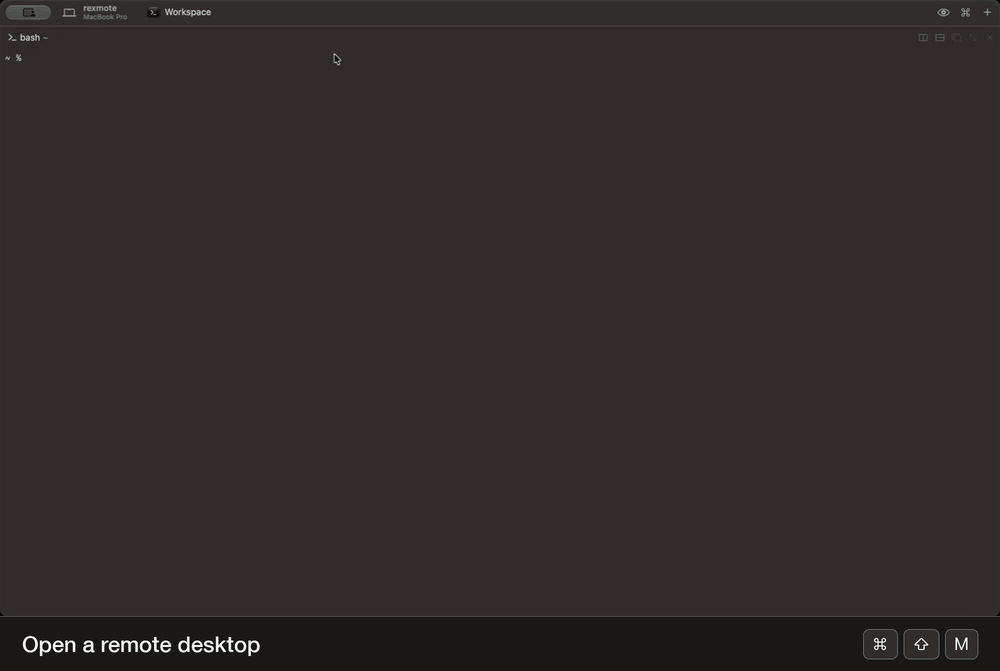

# Rexmote

Open the Mac hosting your Rex session in a pane beside your terminal. Each pane gets its own virtual display. Drag the divider and the remote desktop resizes with it.



The demo runs Rexmote’s installer tests on the session host. The final shot shows captures from two independent desktops side by side.

## Install

You need two Macs running macOS 14 or later, the Xcode Command Line Tools on both, and a working remote Rex session. Download and extract the same Rexmote release on each Mac. Run the commands below from the extracted folder. [Rex installation](https://www.superlogical.com/rex/docs/installation) · [Rexmote releases](https://github.com/rayhanadev/rexmote/releases/latest)

**On the Mac hosting the session**, sign in to macOS and enable **System Settings → General → Sharing → Remote Login** for your account. Rexmote connects over SSH, so Apple Screen Sharing can stay off.

```sh
./install.sh --host-only
~/.local/bin/rexmote setup
```

Grant **Rexmote Host** Screen Recording to show the desktop and Accessibility to control it. If the Mac locks, unlock it on the host. The pane resumes automatically.

**On the viewing Mac**, install the Rex actions and viewer.

```sh
./install.sh
```

In Rex, select the session on the other Mac and press **⌘⇧M**. Enter your SSH password in the pane if prompted.

## Using a pane

Click the desktop to send keystrokes to the remote app. For example, **⌘W** closes the active tab in a remote browser. The pane also forwards trackpad scrolling with momentum, pinch, rotation, swipe, and smart magnify when the remote app supports them.

| Action | Shortcut or command |
| --- | --- |
| Open another desktop pane | **⌘⇧M** with Rex focused |
| Open a desktop in its own tab | **Open Remote Desktop Tab** in the Rex command palette |
| Return keyboard focus to Rex | **Control–Option–backtick** |
| Focus a neighboring Rex pane | **Control–Option–arrow key** |

### Copy and paste

Copy text, links, images, files, or folders with **⌘C** and paste on the other Mac with **⌘V**. Finder transfers use SSH and work across different Apple Accounts.

- To **paste into the pane**, copy your selection in local Finder, open the remote destination folder, and paste. Keep that folder focused until the transfer finishes.
- To **copy out of the pane**, select the files in remote Finder and copy. When Rex reports that the files are ready, paste into a local Finder window.

## Development

Run `swift test` for the pane, host, and transport tests. Run `python3 -m unittest discover -s Tests/Installer` for installer tests. Build the signed app at `dist/Rexmote.app` with `./scripts/build.sh`.

## Uninstall

From the source folder, run `./uninstall.sh` on the viewing Mac and `./uninstall.sh --host-only` on the host.

## License

Rexmote is released under the [MIT License](LICENSE). Its pane integration is adapted from Jordan Coeyman’s rexweb. [rexweb](https://github.com/acoyfellow/rexweb) · [Upstream license](Notices/rexweb-LICENSE)
